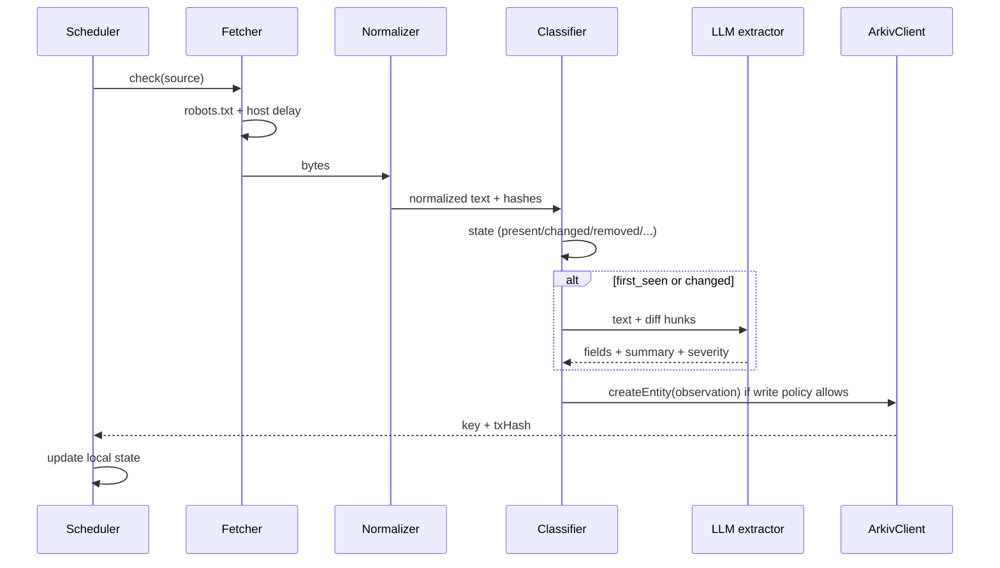
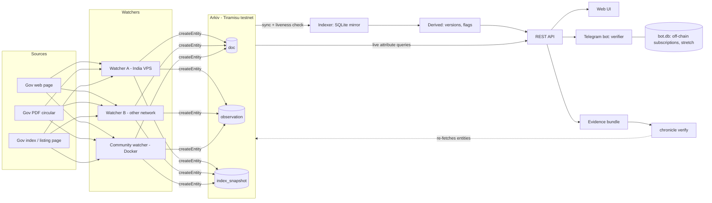

# Chronicle: Cursor build spec

Project: **Chronicle**, a shared, tamper-evident evidence registry for public records that change.
Hackathon: Arkiv: Global Tour Stop. Tracks: Best Indian Use Case (lead) + Censorship Resistance.
Build window: 9-18 Oct 2026. Feature freeze: **17 Oct 12:00 IST**. Submit on the evening of 18 Oct IST.

This file is the single source of truth for Cursor. Read it fully before writing code.

---

## 0. How to use this with Cursor

1. Create the repo `chronicle`. Put this file at the repo root as `CURSOR_SPEC.md`.
2. Create `.cursor/rules/chronicle.mdc` with the content in section 1.
3. Use Cursor **Agent** mode. Feed **one stage at a time**. Paste the "Cursor prompt" at the end of that stage.
4. After each stage: run that stage's acceptance commands. If they pass, commit with message `stage-N: <title>` and tick the box in `PROGRESS.md`.
5. Never let Cursor start the next stage before the current acceptance criteria pass.
6. If Cursor is blocked by Arkiv SDK uncertainty, it must (a) write the problem to `arkiv/friction.md`, (b) keep working against the in-memory `FakeArkivClient`, and (c) never invent SDK function names. Read the SDK source in `node_modules/@arkiv-network/sdk` and `docs.arkiv.network`.
7. Items marked **HUMAN** cannot be done by Cursor. Do them yourself.

### Priority and cut rules

- **Core (must ship):** Stages 0-7 and 9.
- **Open watcher image:** Stage 8.
- **Stretch (only after core passes, in this order):** S1 contradictions, S2 stealth-removal, S3 PDF signature checks, S4 follow-and-alert, S5 verifier extras, S6 Tamil/Hindi.
- Freeze is 17 Oct 12:00 IST. Anything not working end to end then is removed from the demo and the README, not left half-built.
- Time plan: 14 Oct = Stages 0-1 and start 2. 15 Oct = Stages 2-4. 16 Oct = Stages 5-7. 17 Oct morning = Stage 8 + stretch. 17 Oct afternoon = Stage 9. 18 Oct = Stage 10.

### Hackathon gates (every one must be true at submission)

Public deployment judges can open without access. Reproducible steps in README. Public MIT repo. `/arkiv/schema.md`. `/arkiv/friction.md`. Wallet addresses that create entities on Tiramisu listed. Demo video of 3 minutes or less. Every form question answered. Work built 9-18 Oct; any earlier work disclosed with a baseline commit SHA in `BASELINE.md`. No private keys, secrets or real personal data on Arkiv (not even hashed). Deployment stays up until 23 Oct. No history rewrite after the deadline. At least one Indian-national team member (Best Indian Use Case). Re-check the canonical rules repo `Arkiv-Network/global-tour-stop-pre-devcon`, which overrides anything here.

---

## 1. Global rules (put in `.cursor/rules/chronicle.mdc`)

```
---
description: Chronicle project rules
globs:
alwaysApply: true
---
- Read CURSOR_SPEC.md before any change. Work on exactly one stage at a time.
- TypeScript strict mode. No `any`. Validate all external input with zod.
- ALL Arkiv access goes through packages/core/src/arkiv/ (ArkivClient interface). No other package imports @arkiv-network/sdk.
- Never invent Arkiv SDK APIs. Read the SDK source and docs.arkiv.network. If unsure, write to arkiv/friction.md.
- Never put secrets in the repo. Read secrets from environment variables only. .env is gitignored; keep .env.example current.
- Never write personal data, Telegram IDs, chat content, user uploads, or full document text to Arkiv. Only hashes, short summaries, and extracted fields.
- Attributes you will range-query must be numeric. Booleans are stored as numeric 0/1.
- Every function with logic gets a vitest unit test. Use synthetic fixtures only. Never copy real government text into the repo.
- Use pino for logging. Never log secrets, private keys, message contents, or chat IDs.
- Small commits. Message format: "stage-N: <what>".
- Do not add dependencies not listed in CURSOR_SPEC.md without writing the reason in PROGRESS.md.
- When a requirement is ambiguous, pick the simplest option that satisfies the acceptance criteria and note it in PROGRESS.md.
```

---

## 2. Tech stack

- Node.js 20+, pnpm 9 workspaces, TypeScript 5 (strict), ESM.
- Tests: vitest. Lint: eslint + prettier. Runner: tsx.
- Arkiv: `@arkiv-network/sdk` pinned to `0.8.x` (check `docs.arkiv.network` and the SDK source for the exact API).
- HTTP: Fastify 4 (API, demo-site). Validation: zod. Logging: pino.
- Storage (off-chain derived data only): SQLite via `better-sqlite3`.
- HTML parsing: cheerio. Text diff: `diff` (jsdiff). Robots: `robots-parser`. CLI: `commander`.
- PDF: poppler-utils binaries `pdftotext`, `pdfinfo`, `pdfsig` called via `child_process.execFile` (installed in Docker; install locally with `brew install poppler` or `apt-get install poppler-utils`). Demo PDFs generated with `pdf-lib`.
- LLM: Groq (OpenAI-compatible chat completions API, called with `fetch`, strict structured outputs). Model from env `GROQ_MODEL`. (Changed from Anthropic at the owner's request on 16 Oct.)
- Bot: `grammy` (long polling).
- Web: Vite + React 18 + TypeScript + Tailwind + React Router + TanStack Query.
- Docker + docker-compose. Reverse proxy on the VPS: Caddy.

---

## 3. Repo layout

```
chronicle/
  CURSOR_SPEC.md
  PROGRESS.md
  BASELINE.md                 # baseline commit SHA + list of pre-existing work (or "none")
  README.md
  LICENSE                     # MIT
  package.json
  pnpm-workspace.yaml
  tsconfig.base.json
  .eslintrc.cjs  .prettierrc
  .env.example
  .gitignore                  # .env, data/, *.db, node_modules, dist
  .cursor/rules/chronicle.mdc
  arkiv/
    schema.md                 # REQUIRED gate file
    friction.md               # REQUIRED gate file
    probe-results.json        # output of Stage 1
  watchlist.json
  docker-compose.yml
  scripts/
    arkiv-probe.ts
  fixtures/                   # synthetic html/pdf only
  packages/
    core/        # types, hashing, normalization, classification, arkiv wrapper, fake arkiv
    watcher/     # fetch + observe + write to Arkiv
    indexer/     # sync, derived data, REST API, serves web build
    web/         # React UI
    cli/         # chronicle verify / bundle
    bot/         # Telegram bot
    demo-site/   # synthetic "government" site with admin mutation endpoints
```

Package names: `@chronicle/core`, `@chronicle/watcher`, `@chronicle/indexer`, `@chronicle/web`, `@chronicle/cli`, `@chronicle/bot`, `@chronicle/demo-site`.

---

## 4. Environment variables (`.env.example`)

```
# Arkiv
ARKIV_MODE=live                      # live | fake (fake = in-memory, for tests/dev)
ARKIV_CHAIN_ID=7738577
ARKIV_RPC_HTTP=https://rpc.tiramisu.db-chain.testnet.arkiv.network
ARKIV_RPC_WS=wss://rpc.tiramisu.db-chain.testnet.arkiv.network
EXPLORER_BASE=https://tiramisu.explorer.arkiv.network

# Watcher
WATCHER_PRIVATE_KEY=                 # HUMAN: funded testnet wallet. Never commit.
VANTAGE=in-vps                       # label: in-vps | eu-vps | community-<name>
WATCHLIST_PATH=./watchlist.json
WATCHLIST_URL=                       # optional: remote watchlist (used by community Docker image)
DATA_DIR=./data                      # watcher local state (sqlite)
POLL_HOURS_DEFAULT=6
HEARTBEAT_HOURS=24
REQUEST_DELAY_MS_PER_HOST=5000
FETCH_TIMEOUT_MS=20000
USER_AGENT=ChronicleWatcher/1.0 (+https://github.com/OWNER/chronicle; contact: EMAIL)
OBSERVATION_TTL_DAYS=180
RENEW_WHEN_DAYS_LEFT=30
WATCHER_HEALTH_PORT=8081             # GET /health (section 4.2 step 13)

# LLM
GROQ_API_KEY=
GROQ_MODEL=openai/gpt-oss-120b

# Indexer / API
PORT=8080
INDEXER_DB_PATH=./data/indexer.db
SYNC_INTERVAL_SECONDS=20
LIVENESS_INTERVAL_MINUTES=30
DISAGREE_WINDOW_MINUTES=30
BACKDATE_DAYS=7
CLOCK_SKEW_SECONDS=3600

# Bot
TELEGRAM_BOT_TOKEN=                  # HUMAN: from BotFather
API_BASE_URL=http://localhost:8080
BOT_DB_PATH=./data/bot.db
BOT_MAX_FILE_MB=10

# Demo site
DEMO_PORT=4000
DEMO_ADMIN_TOKEN=change-me
```

---

## 5. Final data model on Arkiv

Rules: attributes are string or numeric only. Numeric = JS number (safe integers). Booleans are 0/1. Strings are lowercase unless stated. Empty values are not stored; omit the attribute instead. `schema_v` is always `1`.

Stage 1 may change limits (max attribute count, max payload size, key length). If so, update this section and `arkiv/schema.md` and note it in `PROGRESS.md`.

> **Stage 1 results (applied in Stage 2):** at most 30 user attributes per entity; `str` values at most 128 UTF-8 bytes and never empty; numbers are stored as `u64`; payload limit 128 KB (observation payloads stay under 4 KB). Because of the 128-byte limit, the `doc` attribute `source_url` is only written when the canonical URL fits, and the `doc` payload always carries `source_url`. Free-text stretch attributes (`pdf_producer`, `sig_signer_org`) are truncated to 128 bytes. See `arkiv/schema.md`.

### 5.1 Common

| Attribute | Type | Notes |
|---|---|---|
| `type` | string | `doc` \| `observation` \| `index_snapshot` (stretch: `forgery_report`) |
| `schema_v` | number | 1 |

Writer identity is Arkiv's own `$creator`. Do not duplicate it as an attribute. Current `$owner` is stored separately by the indexer.

### 5.2 `doc`

| Attribute | Type | Notes |
|---|---|---|
| `doc_id` | string | sha256 hex of canonical source URL |
| `notice_id` | string | logical notice id from `watchlist.json` |
| `source_kind` | string | `page` \| `pdf` |
| `source_url` | string | canonical URL |
| `department` | string | slug from watchlist |
| `scheme` | string | slug from watchlist, optional |
| `lang` | string | `en`, `hi`, `ta`, ... |

Payload: `{ "title": "<short title or null>", "registered_vantage": "<vantage>" }`.
Before creating, the watcher queries Arkiv for `type=doc AND doc_id=<id>`. If it exists, skip. Duplicate docs from races are deduplicated by the indexer (earliest creation block wins).

### 5.3 `observation` (the core entity)

| Attribute | Type | Notes |
|---|---|---|
| `type` | string | `observation` |
| `schema_v` | number | 1 |
| `doc_id` | string | |
| `notice_id` | string | |
| `source_kind` | string | `page` \| `pdf` |
| `vantage` | string | label of the watcher environment |
| `observed_at` | number | unix seconds, **watcher's claim** |
| `normalizer_version` | string | e.g. `n1` |
| `state` | string | see 5.3.1 |
| `http_status` | number | 0 if network failure |
| `redirect_chain_len` | number | |
| `raw_sha256` | string | hex of raw bytes (omit on removal/unreachable) |
| `norm_sha256` | string | hex of normalized text (omit on removal/unreachable) |
| `prev_norm_sha256` | string | previous hash this watcher saw (omit if none) |
| `text_extracted` | number | 1 if text hash, 0 if bytes only (scanned PDF) |
| `last_modified_ts` | number | from HTTP header, omit if absent |
| `printed_date_ts` | number | date printed in the document, omit if unknown |
| `deadline_ts` | number | unix seconds of 00:00 IST of the deadline date, omit if none |
| `deadline_date` | string | ISO `YYYY-MM-DD`, for display |
| `amount_paise` | number | integer paise, omit if none |
| `department` | string | |
| `scheme` | string | optional |
| `severity` | number | 0-3, watcher's claim |
| `simhash_hex` | string | stretch S5 only |
| `sig_status` | string | PDFs, stretch S3 |
| `sig_signer_org` | string | PDFs, stretch S3; issuer organization only, never a person's name |
| `pdf_producer` | string | PDFs, stretch S3 |
| `pdf_created_ts` | number | PDFs, stretch S3 |

#### 5.3.1 `state` values

`present` (unchanged heartbeat), `changed` (norm hash differs from this watcher's previous), `first_seen` (first ever observation by this watcher for this doc), `removed_404`, `removed_410`, `redirected`, `soft_removed`, `unreachable`, `delisted` (stretch S2).

Observation payload (JSON, keep under 4 KB, no document text):

```json
{
  "title": "string|null",
  "summary_en": "string <= 240 chars",
  "summary_ta": "string|null",
  "summary_hi": "string|null",
  "final_url": "string",
  "changes": [ { "field": "deadline|amount|text|removed", "from": "string|null", "to": "string|null" } ],
  "extractor": { "model": "string", "confidence": 0.0 },
  "declared_supersedes": "string|null"
}
```

### 5.4 Expiry

Default `expiresIn` for `doc` and `observation` = `OBSERVATION_TTL_DAYS` (180). Stage 1 determines the maximum and the extension API. The watcher runs a daily renewal pass for the latest observation per doc and the doc entity when less than `RENEW_WHEN_DAYS_LEFT` remain.

---

## 6. Derived data (indexer SQLite)

Everything here is recomputable from Arkiv. It is a cache, not evidence.

```sql
CREATE TABLE entities (
  key TEXT PRIMARY KEY,
  type TEXT NOT NULL,
  creator TEXT NOT NULL,
  owner TEXT NOT NULL,
  created_block INTEGER NOT NULL,
  created_ts INTEGER NOT NULL,          -- block timestamp (trusted time)
  tx_hash TEXT,
  expires_block INTEGER,
  attrs_json TEXT NOT NULL,
  payload_json TEXT,
  payload_sha256 TEXT NOT NULL,         -- sha256 of exact payload bytes from Arkiv
  mirror_attrs_sha256 TEXT NOT NULL,    -- sha256 of canonical attrs JSON at first sync
  mirror_payload_sha256 TEXT NOT NULL,
  mirror_owner TEXT NOT NULL,
  status TEXT NOT NULL DEFAULT 'live',  -- live | expired | deleted | modified
  first_synced_ts INTEGER NOT NULL,
  last_checked_ts INTEGER NOT NULL
);
CREATE INDEX idx_entities_type ON entities(type);
CREATE INDEX idx_entities_doc ON entities(json_extract(attrs_json,'$.doc_id'));
CREATE INDEX idx_entities_creator ON entities(creator);

CREATE TABLE docs (
  doc_id TEXT PRIMARY KEY, notice_id TEXT, source_url TEXT, source_kind TEXT,
  department TEXT, scheme TEXT, lang TEXT, title TEXT, doc_entity_key TEXT
);

CREATE TABLE versions (
  doc_id TEXT NOT NULL, normalizer_version TEXT NOT NULL, seq INTEGER NOT NULL,
  norm_sha256 TEXT NOT NULL, first_seen_block INTEGER NOT NULL, first_seen_ts INTEGER NOT NULL,
  first_entity_key TEXT NOT NULL, observer_count INTEGER NOT NULL, status TEXT NOT NULL, -- current|superseded
  deadline_ts INTEGER, amount_paise INTEGER, summary_en TEXT,
  PRIMARY KEY (doc_id, normalizer_version, seq)
);

CREATE TABLE flags (
  id INTEGER PRIMARY KEY AUTOINCREMENT, doc_id TEXT NOT NULL,
  kind TEXT NOT NULL,       -- vantage_disagreement | backdated | clock_skew | reverted | owner_modified | missing | contradiction | stealth_removed | delisted | sig_invalid | metadata_inconsistent
  severity INTEGER NOT NULL, details_json TEXT NOT NULL, entity_keys_json TEXT NOT NULL,
  created_ts INTEGER NOT NULL, resolved_ts INTEGER
);

CREATE TABLE sync_state ( k TEXT PRIMARY KEY, v TEXT NOT NULL );
```

Bot DB (`bot.db`, separate file, never exposed by the API): `subscriptions(chat_id INTEGER, filter_type TEXT, filter_value TEXT, created_ts INTEGER, PRIMARY KEY(chat_id, filter_type, filter_value))` and `alert_log(chat_id, doc_id, norm_sha256, stage, sent_ts)`. Created only in stretch S4.

Watcher local state (`DATA_DIR/watcher.db`):

```sql
CREATE TABLE sources (
  doc_id TEXT PRIMARY KEY, canonical_url TEXT, last_norm_sha256 TEXT, last_state TEXT,
  last_text TEXT,                  -- normalized text, LOCAL ONLY, used for diffs, never published
  last_fields_json TEXT, last_write_ts INTEGER, last_check_ts INTEGER,
  consecutive_failures INTEGER DEFAULT 0, doc_entity_key TEXT, last_obs_entity_key TEXT
);
```

---

## 7. REST API (indexer, Fastify, read-only)

All responses JSON. CORS enabled for GET. Rate limit 60 req/min per IP.

| Method + path | Purpose |
|---|---|
| `GET /api/health` | `{ok, lastSyncTs, entityCount, chainHead}` |
| `GET /api/docs` | list docs. Query: `department`, `scheme`, `state`, `changed_since` (unix), `q`, `limit` (default 50, max 200), `offset` |
| `GET /api/docs/:docId` | doc + versions + current status + flags + observers |
| `GET /api/docs/:docId/timeline` | ordered events: observations with creator, owner, vantage, block, chain time, `observed_at`, state, hashes, summary; derived version boundaries; flags |
| `GET /api/watchers` | per creator: vantage labels, observation count, first/last seen, docs covered |
| `GET /api/entities/:key` | mirror record + live re-check against Arkiv |
| `GET /api/arkiv/changes?days=30&field=deadline\|amount\|any` | **live Arkiv attribute query** (not the cache): `type=observation AND state=changed AND observed_at >= now-days`, optionally `deadline_ts`/`amount_paise` present. Response includes `source:"arkiv-live"` |
| `GET /api/arkiv/by-department/:dept` | live Arkiv query by `department` |
| `GET /api/arkiv/by-creator/:address` | live Arkiv query using `$creator` |
| `POST /api/match` | body `{text}` JSON or multipart `file` (PDF). Normalizes in memory, never stores it. Returns match result (see Stage 6) |
| `GET /api/bundle/:docId` | evidence bundle JSON (Stage 7) |
| `GET /*` | serves `packages/web/dist` (SPA fallback) |

---

## STAGE 0: Repo bootstrap

**Goal:** an empty but fully wired monorepo that builds, lints and tests.

**Tasks**
1. Create the layout in section 3. Initialize pnpm workspace with all seven packages (empty `src/index.ts` each, `package.json` with `name`, `type: module`, `scripts: build/test/lint`).
2. `tsconfig.base.json`: `strict`, `target ES2022`, `module NodeNext`, `moduleResolution NodeNext`, `noUncheckedIndexedAccess`, `exactOptionalPropertyTypes` false, `skipLibCheck` true. Each package extends it with path references.
3. Root scripts: `pnpm build`, `pnpm test`, `pnpm lint`, `pnpm dev:demo`, `pnpm dev:watcher`, `pnpm dev:indexer`, `pnpm dev:web`, `pnpm dev:bot`, `pnpm probe`.
4. Add MIT `LICENSE` (year 2026, owner placeholder), `.gitignore`, `.env.example` (section 4), `PROGRESS.md` with a checkbox list of all stages, empty `arkiv/schema.md` and `arkiv/friction.md` with headings (templates in Stage 9), `BASELINE.md` ("No pre-existing code" or the baseline SHA; **HUMAN** must confirm).
5. Write `.cursor/rules/chronicle.mdc` from section 1.
6. GitHub Actions `ci.yml`: install, build, lint, test on push.
7. Config loader `packages/core/src/config.ts`: zod-parse `process.env` into a typed `Config`. Unknown or missing required vars fail fast with a clear message.

**Acceptance**
- `pnpm install && pnpm build && pnpm lint && pnpm test` all pass.
- `.env` is gitignored, `.env.example` lists every variable in section 4.

> **Cursor prompt (Stage 0):** Read CURSOR_SPEC.md. Implement Stage 0 only. Create the pnpm TypeScript monorepo exactly as in sections 3, 2 and 4, the cursor rule file from section 1, CI workflow, config loader with zod, and the placeholder docs. Do not implement any other stage. Run the acceptance commands and fix failures.

---

## STAGE 1: Arkiv wrapper, fake client, and probe (do this before anything else)

**Goal:** know exactly what Arkiv can and cannot do, and isolate every SDK call behind one interface.

**HUMAN first:** create 2 testnet wallets (watcher A and B). Fund them from the Tiramisu faucet (find it via `hub.arkiv.network` / `docs.arkiv.network`). Put key A in `.env` as `WATCHER_PRIVATE_KEY`. Never commit it.

### 1.1 Interface (`packages/core/src/arkiv/types.ts`)

```ts
export type AttrValue = string | number;
export type Attrs = Record<string, AttrValue>;

export interface ArkivEntityRecord {
  key: string;
  creator: string;            // immutable original writer ($creator)
  owner: string;              // current owner ($owner)
  createdAtBlock: bigint;
  expiresAtBlock: bigint | null;
  txHash: string | null;
  attributes: Attrs;
  payloadBytes: Uint8Array | null;
  payload: unknown | null;    // JSON-decoded if possible
  payloadSha256: string;      // sha256 hex of the exact payload bytes
}

export type WhereOp = 'eq' | 'gt' | 'gte' | 'lt' | 'lte' | 'glob';
export interface Where { attr: string; op: WhereOp; value: AttrValue }

export interface QueryInput {
  where: Where[];                         // AND
  creator?: string; owner?: string;
  orderBy?: { attr: string; dir: 'asc' | 'desc' };
  limit?: number; cursor?: string;
}
export interface QueryResult { items: ArkivEntityRecord[]; nextCursor?: string }

export interface ArkivClient {
  address(): string;                      // the wallet address used for writes
  balance(): Promise<bigint>;
  currentBlock(): Promise<bigint>;
  blockTimestamp(block: bigint): Promise<number>;   // unix seconds
  createEntity(i: { attributes: Attrs; payload: unknown; ttlSeconds: number }): Promise<{ key: string; txHash: string }>;
  extendEntity(key: string, ttlSeconds: number): Promise<{ txHash: string }>;
  getEntity(key: string): Promise<ArkivEntityRecord | null>;
  query(q: QueryInput): Promise<QueryResult>;
  subscribe?(onEntity: (e: ArkivEntityRecord) => void): Promise<() => void>;   // optional; only if the SDK supports it
}
```

### 1.2 Implementations

- `LiveArkivClient` (`arkiv/live.ts`): wraps `@arkiv-network/sdk`. Chain id and RPC from config. Read the SDK source for the real calls (create, get, query builder with `eq/gt/lt` from `@arkiv-network/sdk/query`, `ExpirationTime` helpers, extend, owner/creator metadata). Convert `ttlSeconds` through the SDK's expiry helper; remember `expiresIn` is in **seconds**. Booleans are never sent.
- `FakeArkivClient` (`arkiv/fake.ts`): in-memory, deterministic, supports everything in the interface including expiry, extend, delete (test helper `__delete(key)`), multiple writer addresses (constructor takes an address), block counter, creator/owner, `where` evaluation including numeric range and glob. Used by all unit tests and by `ARKIV_MODE=fake`.
- Factory `createArkivClient(config)` picks live or fake.
- Unit tests for the fake client and for query semantics.

### 1.3 Probe script (`scripts/arkiv-probe.ts`, run with `pnpm probe`)

Runs against the live testnet and writes machine-readable `arkiv/probe-results.json` plus human-readable entries appended to `arkiv/friction.md`. Each experiment is independent and failure-tolerant (catch, record error text, continue).

Experiments:
1. Connectivity: chain id equals 7738577, wallet balance, current block.
2. Create with only string attributes; read back; record fields available (creator, owner, created block, expiry block, tx hash).
3. Attribute type support: string, integer, large integer (> 2^31), float, boolean, empty string, very long string (256/1024 chars), many attributes (10/20/40/80). Record limits and errors.
4. Payload size: 1 KB, 4 KB, 16 KB, 64 KB. Record the max accepted.
5. Query: `eq` string, `glob`, numeric `gt/gte/lt/lte`, AND of several, `$creator`, `$owner`, `$key`, ordering, limit, pagination/cursor. Confirm numeric attributes range-query and string attributes do not.
6. Query by creation block or any synthetic attribute for "created after block N" (record whether it exists). This decides `SYNC_STRATEGY` in the indexer (`block` or `observed_at_window`).
7. Expiry: min and max `expiresIn` accepted; create a very short-lived entity and observe `getEntity` and `query` after expiry; test extend.
8. Mutation permissions: update/delete from the owner; attempt update from a different wallet (expect failure; record exact error).
9. Delete behavior: query and getEntity after delete; query at a past block (`atBlock`/`validAtBlock` if supported) to see if deleted or expired data is recoverable.
10. Whether the original payload is recoverable from the creating transaction (calldata) after expiry or deletion.
11. Event subscription over WebSocket for new entities; record whether it works and its latency.
12. Throughput: create 20 entities sequentially and (if supported) batched; record time and gas.
13. Block timestamp: obtain the timestamp of an entity's creation block via the RPC.
14. Explorer link format for an entity key and a tx hash on `EXPLORER_BASE`.

`friction.md` entry template (one per real issue, written automatically when an experiment fails or surprises):

```
### <short title>
- Date: YYYY-MM-DD
- What I tried: <exact call or command>
- Expected: <what the docs imply>
- Actual: <error text or behavior>
- Reproduce: <numbered steps, SDK version, endpoint>
- Impact: <what it blocked or slowed>
- Suggested fix: <docs or SDK change>
```

**Acceptance**
- `pnpm test` passes for core including fake client tests.
- `pnpm probe` completes and writes `arkiv/probe-results.json` with a field for each experiment (`ok`, `details`).
- `arkiv/friction.md` contains at least the real findings from the run.
- `PROGRESS.md` lists which limits changed the data model in section 5 (if any).

> **Cursor prompt (Stage 1):** Implement Stage 1 only. Create the ArkivClient interface, LiveArkivClient using the real SDK (read node_modules/@arkiv-network/sdk and docs.arkiv.network; do not guess APIs), FakeArkivClient, the factory, and scripts/arkiv-probe.ts with all 14 experiments. Write results to arkiv/probe-results.json and friction entries using the template. Add unit tests. Stop and report anything the SDK cannot do.

---

## STAGE 2: Core domain (`packages/core`)

**Goal:** pure, well-tested functions for canonicalization, hashing, normalization, extraction schema, diffing and classification.

### 2.1 URL canonicalization (`url.ts`)
`canonicalizeUrl(input)`: lowercase scheme and host, drop fragment, drop default ports, remove tracking params (`utm_*`, `fbclid`, `gclid`, `ref`, `source`), sort remaining query params, strip trailing slash except for root, upgrade nothing (keep `http` as given). `docIdFor(url)` = `sha256Hex(canonicalizeUrl(url))`.

### 2.2 Hashing (`hash.ts`)
`sha256Hex(bytes|string)`, `canonicalJson(value)` (sorted keys, no whitespace, UTF-8), `sha256Of(value)`. `NORMALIZER_VERSION = "n1"`. Any change to normalization rules must bump this to `n2` and be documented.

### 2.3 Normalization (`normalize/`)
`normalizeText(raw: string): string` (shared): Unicode NFKC, replace all whitespace runs with one space, trim, lowercase for hashing. Remove volatile patterns from a configurable list `VOLATILE_PATTERNS` (regex, case-insensitive), at minimum: `last updated[^.\n]*`, `visitors?[^.\n]*\d+`, `page (hits|views)[^.\n]*`, `printed on[^.\n]*`, 13-digit and 10-digit epoch-like numbers adjacent to the word `timestamp`, `session[-_ ]?id\s*[:=]\s*\S+`, `csrf\S*`.

`normalizeHtml(html: string, opts: { contentSelector?: string }): { text: string; title: string | null }`:
1. Parse with cheerio.
2. If `contentSelector` is given and matches, use only that subtree. Otherwise use `main`, then `article`, then `body`.
3. Remove `script, style, noscript, nav, header, footer, aside, form, iframe, svg, [aria-hidden=true]` and elements whose class/id matches `/(cookie|banner|advert|ad-|social|share|breadcrumb|counter|visitor|menu)/i`.
4. Extract text, apply `normalizeText`.
5. Title = `<title>` or first `h1`, truncated to 160 chars.

`normalizePdf(bytes: Uint8Array): Promise<{ text: string; textExtracted: boolean; meta: PdfMeta }>`:
1. Write to a temp file (random name, delete in `finally`).
2. `pdftotext -enc UTF-8 <file> -` via `execFile` with a 30 s timeout. Apply `normalizeText`.
3. If extracted text has fewer than 50 characters, set `textExtracted=false` (scanned). Then `norm_sha256 = raw_sha256`.
4. `pdfinfo` to read Producer, Creator, CreationDate, ModDate into `PdfMeta`.

### 2.4 Classification (`classify.ts`)
Input: fetch result `{status, finalUrl, redirectChainLen, contentType, bytes, error?}`, source config (`mustContain`, `kind`), previous state. Output: `{ state, reason }`.

Rules in this order:
1. Network error, timeout, or HTTP 5xx: `unreachable`.
2. HTTP 404: `removed_404`. HTTP 410: `removed_410`.
3. Final canonical URL differs from source canonical URL (ignoring http/https and trailing slash) **and** (final host differs or final path is `/`, `/search*`, `/404*`, `/error*`): `redirected`.
4. HTTP 200 and any of: normalized text under 200 chars; matches `SOFT_REMOVED_PATTERNS` (`not found`, `no longer available`, `page you requested`, `has been removed`, `withdrawn`, `पृष्ठ नहीं मिला`, `இந்த பக்கம் கிடைக்கவில்லை`); or `mustContain` configured and none present: `soft_removed`. (PDFs: missing/invalid PDF header or zero extracted text where previous text existed also counts.)
5. Otherwise, if no previous state: `first_seen`. If norm hash equals previous: `present`. Else `changed`.

### 2.5 Diff and severity (`diff.ts`)
`diffText(prev, next)`: use jsdiff sentence-level diff (split on `. ` and newlines). Return at most 12 hunks, each truncated to 300 chars. Stays local; never published.
`ruleSeverity(state, prevFields, nextFields)`: removal states = 3; `deadline_ts` or `amount_paise` differs = 2; any other `changed` = 1; else 0. Final severity = `max(ruleSeverity, llmSeverity)` clamped 0-3.

### 2.6 Extraction schema (`extract.ts`)
zod `ExtractionSchema`:
```ts
{ title: string|null, department: string|null, scheme: string|null,
  printed_date: string|null /* YYYY-MM-DD */, deadline: string|null /* YYYY-MM-DD */,
  amount_inr: number|null, declared_supersedes: string|null,
  summary_en: string /* <=240 */, severity: 0|1|2|3, confidence: number /* 0..1 */ }
```
`datesToTs(dateStr)` returns unix seconds of 00:00 IST for the date (use fixed offset +05:30). `inrToPaise(n)` = `Math.round(n*100)`.
`extractFields(llm, { text, diffHunks, kind })`: calls Groq with the prompt in Appendix B, forces JSON, validates with zod, retries once on invalid JSON, and on final failure returns a null-field result with `confidence: 0` and `summary_en: "extraction failed"`. Never throws. Truncate input text to 12,000 chars. The `LlmClient` interface is injectable so tests use a stub.

### 2.7 Builders (`observation.ts`)
`buildObservationAttrs(...)` and `buildObservationPayload(...)` that produce exactly the shapes in 5.3 and omit absent optional attributes. Enforce limits found in Stage 1 (payload size, attribute count) with explicit errors.

**Acceptance**
- Unit tests cover: URL canonicalization table (at least 12 cases), normalization stability (same content with different timestamps/visitor counters yields the same hash; a deadline change yields a different hash), PDF normalization using a synthetic PDF from `pdf-lib`, scanned-PDF path, classification for each state, severity rules, extraction with a stubbed LLM including malformed JSON retry, IST timestamp conversion, paise conversion.
- Coverage of `packages/core` at least 85 percent lines.

> **Cursor prompt (Stage 2):** Implement Stage 2 only, in packages/core, exactly per sections 5 and Stage 2. Pure functions, injectable LlmClient, thorough vitest tests with synthetic fixtures in /fixtures. No network calls in tests.

---

## STAGE 3: Demo site (`packages/demo-site`)

**Goal:** a synthetic "government" site you can edit live to drive the demo. **It must be labeled everywhere as a demonstration with synthetic content.**

**Routes (Fastify, port `DEMO_PORT`)**
- `GET /circulars/` (index page, archive style): lists notices with links.
- `GET /circulars/:id` (HTML page). Contains header, nav, footer, visitor counter and "last updated" timestamp (volatile on purpose, to exercise normalization), and a main `<main>` with: title, "Circular No. DEMO/2026/NN", printed date, department, scheme, body, **deadline** and **amount** lines. Banner: "DEMONSTRATION: synthetic notice, not a real government document".
- `GET /circulars/:id.pdf` (PDF generated on request via `pdf-lib` from the same state, with a different layout and metadata producer `Chronicle Demo`).
- `POST /admin/mutate` with header `x-admin-token: DEMO_ADMIN_TOKEN`, JSON body:
  `{ "id": "001", "action": "edit_deadline" | "edit_amount" | "edit_text" | "remove_404" | "remove_410" | "soft_remove" | "redirect" | "delist" | "restore" | "backdate" | "hide_from_vantage", "value": "..." }`
  - `edit_deadline` value `YYYY-MM-DD`; `edit_amount` value rupees; `edit_text` replaces a clause; `redirect` sends 302 to `/circulars/`; `delist` removes the notice from the index but keeps the URL working; `backdate` sets the printed date to an old date; `hide_from_vantage` value is a vantage label: requests with header `x-chronicle-vantage` equal to it get 404 (simulates geo-selective removal; label this as a simulation in the UI).
- `GET /admin/state` returns the current state of all notices (token required).
- `GET /admin` simple HTML control panel with buttons for each action (token entered in the page).
- Seed three notices (`001`, `002`, `003`) with different departments and schemes. State is in memory, resettable via `POST /admin/reset`.
- `GET /robots.txt` allows all.

The watcher sends header `x-chronicle-vantage: <VANTAGE>` on every request.

**Acceptance**
- `pnpm dev:demo` serves the three notices as HTML and PDF.
- Integration tests (supertest-style via Fastify inject) for every admin action and the vantage-specific 404.
- Mutating the deadline changes both the HTML and PDF text; volatile fields (visitor counter, last updated) change on every request without changing the normalized hash.

> **Cursor prompt (Stage 3):** Implement Stage 3 only: the demo-site package per spec, with in-memory state, admin mutation endpoint and panel, PDF generation, and tests. Every page must state it is synthetic.

---

## STAGE 4: Watcher (`packages/watcher`)

**Goal:** a long-running process that watches sources and writes observations to Arkiv.

### 4.1 Watchlist (`watchlist.json`, validated by zod)

```json
{
  "version": 1,
  "indexes": [
    { "index_id": "demo-index", "url": "http://localhost:4000/circulars/", "mode": "archive",
      "link_selector": "a.notice-link", "max_pages": 1 }
  ],
  "items": [
    {
      "notice_id": "demo-001",
      "department": "demo-dept-a",
      "scheme": "demo-scheme-1",
      "lang": "en",
      "index_id": "demo-index",
      "sources": [
        { "url": "http://localhost:4000/circulars/001", "kind": "page", "content_selector": "main", "must_contain": ["circular no."], "poll_hours": 1 },
        { "url": "http://localhost:4000/circulars/001.pdf", "kind": "pdf", "poll_hours": 1 }
      ],
      "enabled": true
    }
  ]
}
```
Also add 10-20 entries for **real public government pages** with `"enabled": false` and `"url": "TODO"`. **HUMAN** picks public pages that allow crawling (check robots.txt and terms), fills URLs, and flips `enabled`. Cursor must not invent real URLs.

### 4.2 Run loop
1. Load config and watchlist (`WATCHLIST_URL` if set, else `WATCHLIST_PATH`). Create the Arkiv client. Log wallet address, balance, vantage. If balance is zero, log a clear error with the faucet note and exit non-zero.
2. For each enabled source, schedule checks every `poll_hours` (default `POLL_HOURS_DEFAULT`) with random jitter of plus or minus 10 percent. Run one pass immediately at startup.
3. Per-host politeness: serialize requests per host with `REQUEST_DELAY_MS_PER_HOST` delay. Fetch robots.txt once per host per 24 h with `robots-parser`; if disallowed for our User-Agent, skip, log `blocked_by_robots`, and write **no** observation.
4. Fetch with `fetch`, timeout `FETCH_TIMEOUT_MS`, follow up to 5 redirects manually (record chain length and final URL), headers: `User-Agent: USER_AGENT`, `x-chronicle-vantage: VANTAGE`, `Accept: text/html,application/pdf,*/*`. Cap body at 25 MB.
5. Compute `raw_sha256`. Normalize (HTML or PDF) per source kind. Classify with core. Apply the failure rule: `unreachable` is written only after 2 consecutive failures; counter in local DB.
6. Extraction: run the LLM only when state is `first_seen` or `changed` (and for heartbeats never). Provide diff hunks for `changed`. On `changed`, compare extracted fields with `last_fields_json` to fill `changes[]`.
7. Write policy (limits entity volume):
   - Always write on state `first_seen`, `changed`, any removal state, `redirected`, `soft_removed`.
   - Write a `present` heartbeat only if `now - last_write_ts >= HEARTBEAT_HOURS`.
   - Never write identical consecutive removal observations more than once per `HEARTBEAT_HOURS`.
8. Registration: if no `doc` entity exists for `doc_id` (local cache, then Arkiv query `type=doc AND doc_id=...`), create it first.
9. Write the observation through `ArkivClient.createEntity` with `ttlSeconds = OBSERVATION_TTL_DAYS*86400`. Update local DB (`last_norm_sha256`, `last_state`, `last_text`, `last_fields_json`, `last_write_ts`, `last_obs_entity_key`). Log key and tx hash.
10. Renewal pass once a day: for each source's `doc_entity_key` and `last_obs_entity_key`, if less than `RENEW_WHEN_DAYS_LEFT` remain, call `extendEntity`.
11. Errors never crash the loop. Each source runs in its own try/catch with backoff (1 min, 5 min, 30 min).
12. Graceful shutdown on SIGINT/SIGTERM. A `--once` flag runs a single pass and exits (used by tests and the demo).
13. A `GET /health` on a tiny HTTP server (port `WATCHER_HEALTH_PORT`, default 8081) returning last pass time, source count, wallet address, vantage.

### 4.3 Sequence (raw Mermaid)



**Acceptance**
- With `ARKIV_MODE=fake` and the demo site running: `pnpm --filter watcher start -- --once` creates `doc` and `observation` entities with `first_seen`; a second run writes nothing (within heartbeat); after `edit_deadline` a run writes `changed` with `deadline_ts` updated and `severity >= 2`; after `remove_404` writes `removed_404`; after `soft_remove` writes `soft_removed`; after `redirect` writes `redirected`.
- Same flow works against live Tiramisu with a funded wallet (**HUMAN** run).
- robots.txt disallow test: no fetch beyond robots, no write.
- Volatile counters on the demo page never cause `changed`.
- Unit tests with the fake client for write policy, failure counters and renewal.

> **Cursor prompt (Stage 4):** Implement Stage 4 only: the watcher package exactly per spec using core and the ArkivClient interface. Add the watchlist zod schema and the demo entries. Write integration tests against demo-site (Fastify inject or a spawned server) and the FakeArkivClient. Do not touch indexer, web, cli or bot.

---

## STAGE 5: Indexer and API (`packages/indexer`)

**Goal:** mirror entities from Arkiv, derive the version chain and flags, expose the REST API.

### 5.1 Sync
Every `SYNC_INTERVAL_SECONDS`:
- Strategy from `arkiv/probe-results.json`:
  - `block`: query entities created after `sync_state.last_block`.
  - `observed_at_window`: query `type=observation AND observed_at >= (last_observed_at - 86400)`, plus `type=doc` and `type=index_snapshot` by creation order; deduplicate by key.
- For each new entity: fetch full record (creator, owner, block, expiry, tx hash, attributes, payload bytes). Fetch the block timestamp (cache per block). Insert into `entities` with mirror columns set once. Upsert `docs` from `doc` entities (earliest creation block wins) and from observation attributes when no `doc` entity exists yet.
- If `subscribe` is supported (Stage 1), use it as an accelerator; polling stays as the source of truth.

### 5.2 Liveness and integrity job (every `LIVENESS_INTERVAL_MINUTES`)
For each non-terminal entity: `getEntity(key)`.
- null and `expires_block` > current block: status `deleted`, flag `missing` (severity 2).
- null and `expires_block` <= current block: status `expired`.
- present but `payload_sha256` or attributes hash differs from the mirror: status `modified`, flag `owner_modified` (severity 3).
- present, owner differs from mirror: update `owner` and note it (not a flag by itself).

### 5.3 Derived computations (deterministic, recomputed per doc after each sync)
Accepted observations = entities of type `observation`, status `live` or `expired`, same `normalizer_version`, state in (`first_seen`, `present`, `changed`).

1. **Version chain:** for each distinct `norm_sha256` find its earliest chain-verified observation (order by `created_block`, tie-break by entity key lexicographically). Order distinct hashes by that moment. `seq` = 1..n. `observer_count` = distinct creators with that hash. **Current version** = the hash that most distinct creators saw in their latest observation within the last 24 h; tie goes to the later `first_seen`. All others `superseded`. Fill `deadline_ts`, `amount_paise`, `summary_en` from the earliest observation of that version.
2. **Vantage disagreement:** for each doc, take the latest observation per creator. If two creators' observations are within `DISAGREE_WINDOW_MINUTES` of each other (by chain time) and have different `norm_sha256` or one is a removal state while another is `present`/`changed`: flag `vantage_disagreement` (severity 2) listing creators, vantages and states.
3. **Backdating:** for a version with `seq > 1`, if the earliest `printed_date_ts` or `last_modified_ts` is more than `BACKDATE_DAYS` earlier than the version's `first_seen_ts` (chain time): flag `backdated` (severity 2). Never flag `seq = 1`.
4. **Clock skew:** if `abs(observed_at - created_ts) > CLOCK_SKEW_SECONDS`: flag `clock_skew` (severity 1). All ordering and `first_seen` use chain time, never `observed_at`.
5. **Reverted:** if current version `seq` is lower than the maximum `seq`, flag `reverted` (severity 1).
6. Flags are idempotent: recomputation updates existing open flags and sets `resolved_ts` when a condition clears.

### 5.4 API
Implement section 7. Specifics:
- `/api/docs/:docId/timeline` merges, ordered by chain time: observation events (creator, owner, vantage, `created_block`, `created_ts`, `observed_at`, state, hashes, summary, severity, `explorer_url`), version-boundary events ("version 2 first seen"), and flags.
- `/api/arkiv/*` endpoints must execute live Arkiv queries through `ArkivClient.query` (not SQLite) and return `source: "arkiv-live"` plus the exact `where` clauses used. This is what proves attribute-query use to judges.
- `/api/entities/:key` returns the mirror row plus a live `getEntity` result and a `matches_mirror` boolean.
- Zod-validate all query params. Errors return `{error, code}`.
- Serve static web build when present.

**Acceptance**
- Integration tests with `FakeArkivClient` seeded by scripted observations: version chain, current version, supersession order, vantage disagreement (two creators, different hashes inside window), backdating, clock skew (observed_at far from chain time), `owner_modified` (mutate a fake entity), `missing` (delete a fake entity).
- With the watcher and demo-site running in fake mode, `GET /api/docs`, `/timeline`, `/api/arkiv/changes?days=30` return correct data.
- `GET /api/health` reports sync status.

> **Cursor prompt (Stage 5):** Implement Stage 5 only: the indexer per sections 6 and 7 and Stage 5, using ArkivClient and better-sqlite3. Write deterministic derivation code as pure functions with tests. Do not modify watcher or core except for bug fixes noted in PROGRESS.md.

---

## STAGE 6: Web UI (`packages/web`) and verifier endpoint

**Goal:** a clear public UI and the matching endpoint the bot will use.

### 6.1 `POST /api/match` (in indexer)
Input: JSON `{ text }` or multipart `file` (PDF, max `BOT_MAX_FILE_MB`). Processing entirely in memory; nothing is persisted or logged.
1. If file: `normalizePdf` -> `norm_sha256`, `raw_sha256`. If text: `normalizeText` -> `norm_sha256`.
2. Look up `versions` by `norm_sha256` (and `raw_sha256` for exact file matches via observation attributes).
3. Response:
```json
{ "result": "exact_match" | "no_match",
  "match": { "doc_id": "...", "title": "...", "department": "...", "version_seq": 2, "current_seq": 4,
             "status": "current|superseded", "superseded_at": 1760000000, "observer_count": 3,
             "changes_since": [ { "seq": 3, "summary_en": "...", "first_seen_ts": 0 } ], "timeline_url": "..." },
  "note": "string" }
```
`note` is plain language, for example: "Matches version 2, which was superseded on 12 Oct. Version 4 is current." or "No exact match. Treat as unverified. This does not mean it is forged."

Honest limitation (state it in the UI and README): exact matching works best for the same PDF or complete pasted text. Pasted WhatsApp text often differs in formatting.

### 6.2 UI pages (Vite + React + Tailwind, dark/light via `prefers-color-scheme`)
- **Home `/`**: header "Chronicle: a public memory for records that change", one-paragraph explanation, summary counters (docs tracked, observations, distinct watchers, changes in 30 days). Table of docs with department, scheme, state badge (Current / Changed / Removed / Disputed), last change, observers count, flag icons. Filters: department, scheme, state, changed since. Filters for "deadline changed" and "amount changed" call `/api/arkiv/changes` and show a "Live Arkiv query" tag with the query used.
- **Doc `/docs/:docId`**: title, source URLs, version list (v1..vN with first-seen time, summary, observers, status), flags panel (plain-language explanation for each flag kind), vertical **timeline** of events: each shows creator address (shortened, copy button), "Original writer (creator)" and "Current owner" if different, vantage label, chain time and `observed_at` side by side (skew warning if flagged), state, hashes (truncated, copy), summary, link to explorer. Button **Export evidence bundle** (downloads `/api/bundle/:docId`). Button **Copy verify command**.
- **Verify `/verify`**: upload a PDF or paste text, calls `/api/match`, shows result and the plain note. Privacy notice: processed in memory, not stored.
- **Watchers `/watchers`**: table of creator addresses, vantage labels, counts, first/last seen, docs covered. Banner: "More watchers means more corroboration, not proof of truth. Several wallets can belong to one person."
- **About `/about`**: what Chronicle proves and does not prove (observed, when, by whom; not authenticity, not why), data kept off Arkiv, limitations (expiry, testnet), links to repo, `arkiv/schema.md`, how to run a watcher.
- Persistent footer: "Demonstration build on Arkiv Tiramisu testnet. Not legal advice."

### 6.3 UI rules
Never use the words "fraud" or "fake" for system-generated flags. Use "sources disagree", "changed", "removed from listing", "no digital signature". Loading and error states on every query. Responsive down to 360 px. Accessible contrast, keyboard navigable.

**Acceptance**
- `pnpm --filter web build` produces `dist`, served by the indexer at `/`.
- Playwright (or vitest + testing-library) smoke tests: home renders docs from a seeded fake backend, doc page renders timeline, verify page returns `exact_match` for a seeded PDF and `no_match` otherwise.
- Manual: Home, Doc, Verify, Watchers, About all load with real data from the demo flow.

> **Cursor prompt (Stage 6):** Implement Stage 6 only: /api/match in the indexer and the React UI per spec. Reuse the generated types from API zod schemas. Keep the design clean and plain-language. No new backend features beyond /api/match.

---

## STAGE 7: Evidence bundle and CLI (`packages/cli`, plus `/api/bundle`)

**Goal:** an export that can be checked against the chain without trusting Chronicle's server.

### 7.1 Bundle format (`bundle_version: 1`)
```json
{
  "bundle_version": 1,
  "generated_at": 1760000000,
  "chain_id": 7738577,
  "rpc": "https://rpc.tiramisu.db-chain.testnet.arkiv.network",
  "doc": { "doc_id": "...", "notice_id": "...", "source_url": "...", "department": "...", "title": "..." },
  "versions": [ { "seq": 1, "norm_sha256": "...", "first_seen_ts": 0, "first_entity_key": "...", "status": "superseded" } ],
  "flags": [ { "kind": "...", "severity": 2, "entity_keys": ["..."] } ],
  "entries": [
    {
      "entity_key": "...",
      "tx_hash": "...",
      "creator": "0x...",
      "owner": "0x...",
      "creation_block": 0,
      "creation_ts": 0,
      "expiry_block": 0,
      "attributes": { "doc_id": "...", "state": "changed", "norm_sha256": "..." },
      "payload_sha256": "..."
    }
  ],
  "bundle_sha256": "<sha256 of canonical JSON of the object without this field>"
}
```
`/api/bundle/:docId` builds it from the mirror. Entries are ordered by `(creation_block, entity_key)`.

### 7.2 CLI
Commands (`chronicle` binary):
- `chronicle bundle <doc_id> [--api URL] [--out file]`: fetch a bundle from an API.
- `chronicle verify <bundle.json> [--rpc URL]`: default RPC from the bundle.
- `chronicle entity <key> [--rpc URL]`: print live creator, owner, block, expiry, attributes.

`verify` steps:
1. Parse with zod. Recompute `bundle_sha256` and compare.
2. For each entry: fetch the entity from the RPC through `ArkivClient`.
   - Found: compare `creator`, `owner`, `creation_block`, `expiry_block`, every attribute in the bundle, and `payload_sha256`. Confirm the tx hash exists on chain and sits in the claimed creation block.
   - Not found and `expiry_block` has passed: `EXPIRED`. Not found and not expired: `DELETED`. For both, check whether the creating transaction still exists (per Stage 1 findings) and print what remains provable.
   - Owner differs from the bundle: `OWNER_CHANGED` (informational, not failure).
3. Output a table: entry, state (PASS / FAIL / EXPIRED / DELETED / OWNER_CHANGED), creator, vantage, detail. Then the list of distinct creators.
4. Exit codes: `0` all PASS (OWNER_CHANGED allowed), `1` any FAIL or DELETED, `2` no FAIL but some EXPIRED.
5. Print this disclaimer at the end: "This verifies the bundle against Arkiv records. It shows what watchers recorded and when. It does not prove a document is authentic or why it changed. Not legal advice."

**Acceptance**
- Tests with `FakeArkivClient`: valid bundle passes; tampering with one attribute byte in the bundle fails; deleting the entity yields DELETED; expiring yields EXPIRED; flipped `bundle_sha256` fails.
- Manual live test: export a real bundle from the running app, `chronicle verify` returns exit code 0; edit one byte, returns 1.

> **Cursor prompt (Stage 7):** Implement Stage 7 only: /api/bundle in the indexer and the CLI package with bundle, verify and entity commands as specified. Use ArkivClient only. Include the tamper tests.

---

## STAGE 8: Docker, open watcher, deployment files

**Goal:** anyone can run a watcher with one command, and the app deploys with one compose file.

**Tasks**
1. `packages/watcher/Dockerfile`: `node:20-slim`, `apt-get install -y poppler-utils ca-certificates`, pnpm build, non-root user, `ENTRYPOINT ["node","dist/main.js"]`, `HEALTHCHECK` on `/health`.
2. `Dockerfile.app` for indexer + web + bot (multi-stage; web built then copied; poppler-utils installed since `/api/match` parses PDFs).
3. `docker-compose.yml` services: `app` (indexer+web, port 8080), `watcher-a` (vantage `in-vps`), `demo-site` (port 4000), optional `bot`. Volumes for `./data`. Env from `.env`.
4. README section "Run a community watcher" with exactly:
```
docker run --rm \
  -e WATCHER_PRIVATE_KEY=0xYOUR_FUNDED_TESTNET_KEY \
  -e VANTAGE=community-yourname \
  -e WATCHLIST_URL=https://raw.githubusercontent.com/OWNER/chronicle/main/watchlist.json \
  -e ARKIV_MODE=live \
  ghcr.io/OWNER/chronicle-watcher:latest
```
plus the faucet steps and a note that a wallet on the same machine is not an independent vantage.
5. GitHub Action to build and push the watcher image to GHCR on tag.
6. Watcher refuses to run with the demo watchlist entries when `NODE_ENV=production` unless `ALLOW_DEMO=1`.
7. **HUMAN:** provision VPS 1 (India region) for `app` + `watcher-a`; VPS 2 (different network or region) for `watcher-b`; point a domain, Caddy for HTTPS (reverse proxy to 8080). Keep deployment up until 23 Oct.

**Acceptance**
- `docker compose up --build` starts app, demo-site and watcher-a; UI reachable on `localhost:8080`.
- `docker run` of the watcher image with the demo watchlist and fake mode prints an observation.
- Image size and startup logged in `PROGRESS.md`.

> **Cursor prompt (Stage 8):** Implement Stage 8 only: Dockerfiles, compose, GHCR workflow, README run-a-watcher section, and the production guard. Do not change application logic.

---

## STAGE 9: Documentation, hardening, and demo data (afternoon of 17 Oct)

**Tasks**
1. `arkiv/schema.md` (gate file). Sections: Overview; Entities and every attribute (copy from section 5 with final limits found in Stage 1); Time semantics (`observed_at` vs chain creation block vs `first_seen`); Why each field is an attribute (which queries use it) with the exact queries; What is deliberately kept off Arkiv and why (document text, user uploads, Telegram IDs, personal data, signer names); Expiry, deletion and testnet limitations with results of Stage 1; Trust model (creator vs owner, sybil, lying watchers, independent vantages); Wallet addresses used (**HUMAN** fills the final list); Derived data is recomputable.
2. `arkiv/friction.md` (gate file): all entries from probe and development using the template. Must be specific and reproducible: SDK version, endpoint, exact calls, outputs.
3. `README.md`: what/why, architecture diagram (raw Mermaid from Appendix A), quick start (fake mode, 3 commands), live mode setup, how to reproduce the demo, how to run a watcher, how to verify a bundle, honest limitations, hackathon gates checklist, license, baseline SHA note, tracks entered.
4. Security pass: no secrets in git history (`git log -p | grep -i key` style check, use `gitleaks` if available), `.env` ignored, API read-only, rate limits on, bot never logs content, `/api/match` never stores uploads (test that no file or text is written to disk or DB).
5. Privacy pass: query Arkiv for every entity type and confirm no attribute or payload holds text from documents, personal names, phone numbers, chat IDs. Add an automated test scanning payloads from the fake run for forbidden patterns (phone-like numbers, emails, `chat`).
6. Seed data: run the watcher against the demo site through at least three change events (deadline edit, soft removal, restore) from two wallets in two networks, so the live UI shows real multi-writer history. Run on 10-20 enabled real pages from 14 Oct onward (**HUMAN**).
7. `PROGRESS.md` final status and a list of what was cut.

**Acceptance**
- `arkiv/schema.md` and `arkiv/friction.md` exist, specific, and match the code.
- README steps reproduce the demo from a clean clone in fake mode and in live mode.
- Privacy test passes.

> **Cursor prompt (Stage 9):** Implement Stage 9 only: write arkiv/schema.md, arkiv/friction.md (consolidating existing entries), README.md, add the privacy and no-persistence tests, and a seed script `pnpm seed:demo` that drives the demo site through the demo sequence. Base the docs strictly on the actual code and probe results.

---

## STAGE 10: Demo, submission, freeze (18 Oct)

**HUMAN tasks**
1. Re-run the full demo from the deployed version once, end to end, twice.
2. Record the video (3 minutes max) using the script in Appendix C.
3. Fill the submission form: tracks (Best Indian Use Case + Censorship Resistance), repo, deployment, wallet addresses, baseline SHA, video.
4. Record the final commit SHA at submission. No history rewrites afterward.
5. Submit on the **evening of 18 Oct IST**. The deadline is 23:59 BST (about 04:29 IST on 19 Oct); do not use that margin.
6. Keep the deployment, watchers, and demo site running until 23 Oct.

---

## STRETCH STAGES (only after Stage 9 passes and only before the freeze)

### S1: Contradictions
Indexer job: for each `notice_id` with sources of both kinds, compare the latest `deadline_ts` and `amount_paise` of the page and the PDF. If they differ, flag `contradiction` (severity 2) with both entity keys. UI badge "sources disagree: page says X, PDF says Y". Wording never says fraud. Demo-site `edit_deadline` accepts a `target` option (`page`|`pdf`|`both`) to create the situation. Tests with the fake client.

### S2: Stealth-removal on index pages
Watcher: for each `indexes[]` entry, fetch and parse links with `link_selector` (first `max_pages` pages), write an `index_snapshot` entity (attrs: `index_id`, `index_mode`, `observed_at`, `link_count`, `links_sha256`; payload `{links:[{doc_id,title<=120}]}`). Only for `mode: archive`; skip `rolling`.
Indexer: diff consecutive snapshots from the same creator. For a vanished doc: URL still 200 in latest observation -> flag `delisted`; 404/410 and no matching "withdrawn|cancelled|corrigendum|superseded" title appeared -> flag `stealth_removed`; matching title appeared -> informational `declared_withdrawn`. Corroborate across creators before showing as high severity. Wording: "removed from listing without a withdrawal notice".

### S3: PDF signature and provenance
Watcher: run `pdfsig <file>` on PDFs. Set `sig_status` to `signed_valid` | `signed_modified` | `signed_invalid` | `unsigned`. Parse issuer organization only into `sig_signer_org`; never store an individual's name. Read `pdf_producer`, `pdf_created_ts`. Indexer flags: `sig_invalid` (invalid or modified after signing, severity 3); `metadata_inconsistent` (soft, severity 1) when `pdf_created_ts` is later than `printed_date_ts` by more than 30 days or the producer is a known online editor. Unsigned is shown neutrally: "No digital signature. Many genuine circulars are unsigned." Never say "authentic". Chain-of-trust validation is out of scope; say "signature intact".

### S4: Telegram follow-and-alert
Not in the baseline demo. Include in the demo only if the whole path works before the freeze.
- Commands: `/follow <department|scheme|doc_id|keyword>`, `/unfollow`, `/list`.
- Subscriptions stored only in `bot.db`. Never on Arkiv. Never logged.
- Dispatcher watches Arkiv (event subscription if available, otherwise poll the indexer's `/api/docs?changed_since=` every minute).
- Two-stage alerts: send "UNCONFIRMED: 1 watcher reports a change" for severity >= 2; send "CONFIRMED: 2+ distinct creators agree" when a second creator matches the same `norm_sha256`. Dedupe by `(doc_id, norm_sha256, stage)`. Max 5 alerts per chat per hour.
- Message format:
```
Chronicle alert: <department> - <title>
Change: deadline 15 Nov -> 30 Oct (severity 2)
Seen by: 2 watchers, first at <time UTC>
Timeline: <url>
```

### S5: Verifier extras
In order: forgery-report counts (`forgery_report` entity: `norm_sha256`, `reason_code`, `real_source_url`; reporter is `$creator`; display distinct creators), near-match via SimHash (`simhash_hex` attribute written by watchers; match in indexer by Hamming distance <= 3; label "similar, not identical"), reply language.

### S6: Tamil/Hindi summaries
Extend the extraction prompt to output `summary_ta` and `summary_hi`; store in payload; UI toggle; label "machine-generated". Last priority.

---

## STAGE 6B: Telegram bot (baseline, MUST) (`packages/bot`)

This is a firm milestone, built right after Stage 6 (16 Oct). Baseline = exact-hash match and version lookup only.

**Behavior**
- Library: grammy, long polling, token from `TELEGRAM_BOT_TOKEN`.
- `/start` and `/help`: explain in plain language what the bot does, that it checks a document against Chronicle's registry, that it does not store files or messages, and that "no match" does not mean forged.
- Text message (at least 200 characters): `POST {API_BASE_URL}/api/match` with `{text}`.
- PDF document upload (max `BOT_MAX_FILE_MB`): download in memory, `POST` as multipart. Reject other file types politely.
- Reply by result:
  - exact match: "This matches version {n} of {title} ({department}). Status: {current | superseded on DD Mon by version {m}}. Seen by {k} independent watchers. Timeline: {url}" plus the latest change summary if superseded.
  - no match: "I couldn't find an exact match in the registry. Treat it as unverified. This does not mean it is fake. Pasted text often differs from the original; try uploading the PDF."
- Rate limit: max 10 requests per chat per hour (in memory).
- **Privacy:** never write message text, file bytes, usernames or chat IDs to disk or logs, never send them to Arkiv. Log only counts. Explicit test that the code path has no persistence.
- Language: English baseline (extras in S5).

**Acceptance**
- Unit tests with a stubbed API: text match, PDF match, no match, non-PDF rejected, oversized file rejected, rate limit.
- **HUMAN:** create the bot with BotFather, set the token, run `pnpm dev:bot`, send a demo PDF and see the exact-match reply.

> **Cursor prompt (Stage 6B):** Implement the baseline Telegram bot only. No subscriptions, no alerts, no fuzzy matching. Add the no-persistence tests.

---

## Appendix A: Architecture (raw Mermaid)



## Appendix B: LLM extraction prompt

System prompt:
```
You extract structured facts from an official public notice for a change-monitoring registry.
Return ONLY a JSON object matching the schema. No markdown, no commentary.
Rules:
- Use only information present in the provided text. If a field is absent, use null.
- Dates must be ISO YYYY-MM-DD. If the text gives a date in another format, convert it. If ambiguous, use null.
- amount_inr is a number in rupees (no symbols, no commas). If several amounts appear, use the main sanctioned/benefit/fee amount; else null.
- declared_supersedes: copy a short reference if the notice says it replaces or supersedes another notice (for example "Circular No. 14/2026 dated 2026-09-02"); else null.
- summary_en: one neutral sentence (max 240 characters) describing what changed, based on the diff hunks when provided, otherwise what the notice is about. Do not speculate about reasons or intent.
- severity: 0 cosmetic, 1 wording change, 2 change to a deadline, amount, eligibility or obligation, 3 removal of a clause or the whole notice.
- confidence: 0.0-1.0, your confidence in the extracted fields.
- department and scheme: short lowercase slugs from the text, else null.
- Never output personal names or contact details.
```
User message: JSON with `kind` (`page`|`pdf`), `text` (max 12,000 chars), `diff_hunks` (array, may be empty), `previous_fields` (may be null).

## Appendix C: 3-minute demo script

1. (0:00-0:20) Problem: circulars are silently edited, withdrawn or forged; people forward them on WhatsApp. Show Chronicle home with real watched pages.
2. (0:20-0:50) Act 1, Publish: demo notice 001 is registered. Show the `doc` and first `observation` in the Tiramisu explorer, with creator address.
3. (0:50-1:30) Act 2, Change: in the demo admin panel change the deadline (15 Nov to 30 Oct). Two watchers on two networks, two distinct wallets, record new observations. If it works before the freeze, a third community Docker watcher joins live.
4. (1:30-2:00) Act 3, Verify: timeline shows v1 to v2, severity 2, observations from 2 creators, chain time vs claimed time, "Live Arkiv query" panel listing deadline changes.
5. (2:00-2:20) Telegram: forward the old PDF to the bot; it replies "matches version 1, superseded by version 2".
6. (2:20-2:45) Export the evidence bundle, run `chronicle verify` (PASS), flip one byte (FAIL).
7. (2:45-3:00) Why Arkiv in one sentence: independent writers, no operator can alter their records, attribute queries, chain time. State the limits: expiry and testnet.

## Appendix D: Definition of done checklist (copy into PROGRESS.md)

- [ ] S0 repo, CI green
- [ ] S1 wrapper, fake client, probe results, friction entries
- [ ] S2 core domain, tests >= 85 percent
- [ ] S3 demo site with admin mutations
- [ ] S4 watcher, writes to fake and live Arkiv
- [ ] S5 indexer, derived data, API, live attribute-query endpoints
- [ ] S6 web UI + /api/match
- [ ] S6B Telegram bot baseline
- [ ] S7 evidence bundle + CLI verify
- [ ] S8 Docker, compose, community watcher instructions
- [ ] S9 schema.md, friction.md, README, privacy tests, seed demo
- [ ] Two distinct funded wallets, two networks, observations on live Tiramisu
- [ ] 10-20 real public pages watched since 14 Oct (HUMAN)
- [ ] Deployment public and stable
- [ ] Demo video <= 3 minutes
- [ ] Form submitted, SHA recorded
- [ ] Stretch items attempted only after core, cut at 17 Oct 12:00 IST
