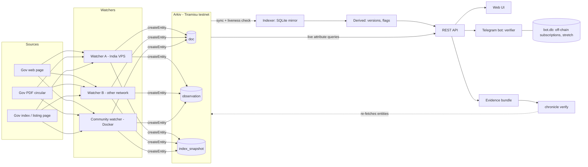

# Chronicle

Shared, tamper-evident **evidence registry** for public records that change (government circulars, notices, PDFs). Independent watchers fetch sources, hash and classify what they see, and write **observations** to [Arkiv](https://docs.arkiv.network) (Tiramisu testnet). An indexer mirrors the chain, derives versions/flags, and serves a public UI and evidence bundles.

**Hackathon:** Arkiv Global Tour Stop — tracks **Best Indian Use Case** (lead) and **Censorship Resistance**. Build window 9–18 Oct 2026.

Chronicle proves *what was observed, when, by whom* (wallet + vantage label). It does **not** prove authenticity, intent, or that a notice is “real.”

## Architecture



## Quick start (fake mode)

Three commands from a clean clone (Node 20+, pnpm 9, [poppler](https://poppler.freedesktop.org/) for PDFs):

```bash
pnpm install
pnpm build
pnpm dev:fake
```

Then open http://localhost:8080 (UI + API). Demo site: http://localhost:4000 (admin token from `.env.example`, default `change-me`).

`pnpm dev:fake` runs demo site + watcher + indexer in **one process** on one in-memory Arkiv chain. Restarting clears the chain.

Seed the demo sequence (deadline edit → soft remove → restore) with two synthetic wallets:

```bash
pnpm seed:demo
```

## Live mode setup

1. Copy `.env.example` → `.env` (never commit `.env`).
2. Set `ARKIV_MODE=live` and a **funded** `WATCHER_PRIVATE_KEY` (Tiramisu faucet via [hub.arkiv.network](https://hub.arkiv.network) / [docs.arkiv.network](https://docs.arkiv.network)).
3. Optional: `GROQ_API_KEY` for LLM extraction (otherwise rule-based `rules-v1`).
4. Run demo site, watcher, and indexer (separate terminals), or `docker compose up --build` with live keys.

```bash
pnpm dev:demo
pnpm dev:watcher          # add -- --once for a single pass
pnpm dev:indexer
```

Wallet addresses that wrote live entities are listed in [`arkiv/schema.md`](arkiv/schema.md) (HUMAN completes the final list).

## Reproduce the demo

1. `pnpm seed:demo` or manually: start `dev:fake`, open demo admin, `edit_deadline` on notice 001, wait for the watcher, then soft-remove / restore.
2. UI: home list → doc timeline (versions, flags, creators) → Verify page (`/api/match`) → Watchers.
3. Download evidence bundle from the doc page (`/api/bundle/:docId`).
4. `pnpm --filter @chronicle/cli exec chronicle verify <bundle.json>`.

## Run a community watcher

Anyone can add an independent vantage with one Docker command. Use a **funded** Tiramisu testnet key that is **not** the same wallet as the VPS watchers.

```
docker run --rm \
  -e WATCHER_PRIVATE_KEY=0xYOUR_FUNDED_TESTNET_KEY \
  -e VANTAGE=community-yourname \
  -e WATCHLIST_URL=https://raw.githubusercontent.com/ashihams/chronicle/main/watchlist.json \
  -e ARKIV_MODE=live \
  ghcr.io/ashihams/chronicle-watcher:latest
```

### Faucet

1. Create a fresh wallet (or use one you control).
2. Fund it from the Tiramisu testnet faucet (linked from [hub.arkiv.network](https://hub.arkiv.network) and [docs.arkiv.network](https://docs.arkiv.network)).
3. Set `WATCHER_PRIVATE_KEY` to that key only via the environment (never commit it).
4. Restart the container after funding; a zero balance exits with a clear error.

### Vantage note

A wallet on the **same machine** (or the same residential IP / cloud region) as another Chronicle watcher is **not** an independent vantage. Judges look for distinct networks. Prefer a different host, VPN egress, or region, and set `VANTAGE=community-<yourname>` so the UI can show the label.

### Local compose (app + demo + watcher-a)

```bash
docker compose up --build
```

- UI: http://localhost:8080  
- Demo site: http://localhost:4000  
- Watcher health: http://localhost:8081/health  

Compose sets `ALLOW_DEMO=1` so the synthetic demo watchlist is allowed under `NODE_ENV=production`. For real pages, omit `ALLOW_DEMO` and point `WATCHLIST_PATH` / `WATCHLIST_URL` at non-demo entries.

Fake mode is **per-process**: watcher and indexer containers do not share an in-memory chain. Use live mode with funded keys for a shared chain across containers, or `pnpm dev:fake` on the host.

## Verify a bundle

```bash
pnpm --filter @chronicle/cli exec chronicle bundle <doc_id> --api http://localhost:8080 --out bundle.json
pnpm --filter @chronicle/cli exec chronicle verify bundle.json
pnpm --filter @chronicle/cli exec chronicle entity <entity_key>
```

`verify` re-fetches each entity from Arkiv (or fake client in tests), checks hashes/creators/blocks, and exits 0 (PASS), 1 (FAIL), or 2 (EXPIRED/DELETED/OWNER_CHANGED per CLI docs).

## Honest limitations

- Testnet expiry (~180 day TTL) and faucet funding.
- Watchers can lie; trust comes from multiple independent creators, not a single operator.
- Normalizer and extractor versions matter; different normalizers produce different hashes.
- Indexer SQLite is a cache — operators can serve a false UI; use `chronicle verify` against the chain.
- Fake mode does not span processes/containers.
- Telegram bot baseline (Stage 6B) and stretch features may be cut before freeze — see `PROGRESS.md`.
- Explorer deep-link formats need HUMAN confirmation (SPA returns 200 for all paths).

## Hackathon gates checklist

- [ ] Public deployment judges can open
- [ ] Reproducible README steps (this file)
- [ ] Public MIT repo
- [ ] [`arkiv/schema.md`](arkiv/schema.md)
- [ ] [`arkiv/friction.md`](arkiv/friction.md)
- [ ] Wallet addresses that create entities listed in schema
- [ ] Demo video ≤ 3 minutes
- [ ] Form questions answered
- [ ] Built 9–18 Oct; baseline in [`BASELINE.md`](BASELINE.md)
- [ ] No private keys / secrets / personal data on Arkiv
- [ ] Deployment up until 23 Oct
- [ ] No history rewrite after deadline
- [ ] Indian-national team member (Best Indian Use Case)

## Baseline

See [`BASELINE.md`](BASELINE.md). Stated baseline: no pre-existing code; first commit is Stage 0 bootstrap (**HUMAN** must confirm before submission).

## Tracks entered

- Best Indian Use Case (lead)
- Censorship Resistance

## License

MIT — see [`LICENSE`](LICENSE).
